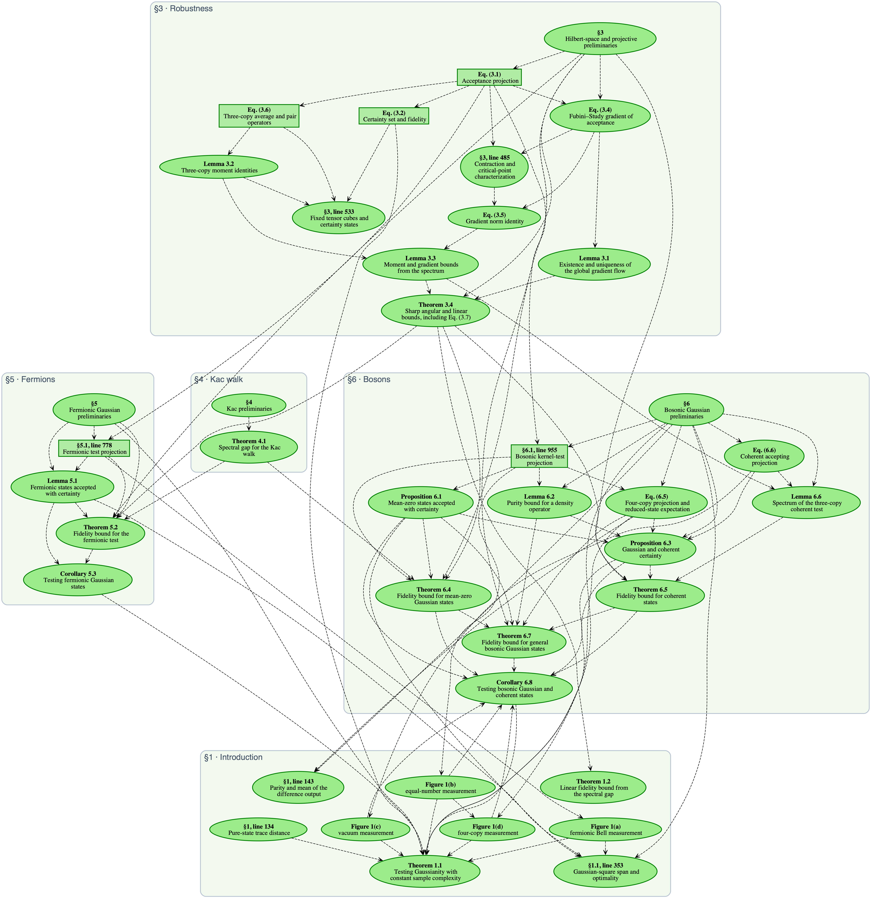

# Testing bosonic and fermionic Gaussian states with a constant number of copies

Lean + Mathlib formalization of the paper by Jop Briët, Davi Castro-Silva, Michael Walter, and Freek Witteveen ([arXiv:2610.06794](https://arxiv.org/abs/2610.06794)).

[Manuscript](material/manuscript.tex) ·
[Blueprint](https://qit-lmu.github.io/gaussian-testing/) ·
[PDF](https://qit-lmu.github.io/gaussian-testing/blueprint.pdf) ·
[Coverage](docs/coverage.md)

The library proves all numbered manuscript results and the four measurement circuits in the introduction.

## Main results

### Theorem 1.1 — Testing Gaussianity

For pure input states, bosonic and fermionic Gaussianity can be tested with $O(\varepsilon^{-2} \log(1/\delta))$ copies, independently of the number of modes. A Gaussian input is always accepted. If its squared overlap with every Gaussian state is at most $1 - \varepsilon^2$ (that is, the trace distance is at least $\varepsilon$), it is rejected with probability at least $1 − δ$.

In [Testing.lean](GaussianTesting/Testing.lean), `n` counts independent rounds, `μ.real` is event probability, and `repeatedTestAccepts n` means all rounds accept.

Fermionic rounds use two copies:

```lean
theorem fermionic_gaussian_testing {m : ℕ} (ψ : HF m) (hψ : ‖ψ‖ = 1) {ε δ : ℝ}
    (hε : ε ∈ Set.Ioo (0 : ℝ) 1) (hδ : δ ∈ Set.Ioo (0 : ℝ) 1) :
    let n := testingRounds 8 ε δ
    let μ := fermionicTestProtocol ψ hψ ε δ
    (ψ ∈ fermionicGaussianStates m → μ.real (repeatedTestAccepts n) = 1) ∧
    ((∀ φ ∈ fermionicGaussianStates m, ‖⟪ψ, φ⟫_ℂ‖ ^ 2 ≤ 1 - ε ^ 2) →
      μ.real (repeatedTestAccepts n) ≤ δ ∧
      1 - δ ≤ μ.real (repeatedTestAccepts n)ᶜ) ∧
    fermionicTestCopies ε δ = 2 * n ∧
    (fermionicTestCopies ε δ : ℝ) ≤ 16 / ε ^ 2 * Real.log (1 / δ) + 2 :=
  GaussianTesting.fermionic_gaussian_testing ψ hψ hε hδ
```

For bosons, `k` selects general Gaussian states, mean-zero Gaussian states, or coherent states. Their rounds use four, two, and two copies respectively, with fidelity constants $48$, $8$, and $4$. `WaveSpace m` is the physical Hilbert space $L^2(\mathbb R^m)$:

```lean
theorem bosonic_gaussian_testing (k : BosonicTestKind) {m : ℕ}
    (ψ : WaveSpace m) (hψ : ‖ψ‖ = 1)
    {ε δ : ℝ} (hε : ε ∈ Set.Ioo (0 : ℝ) 1) (hδ : δ ∈ Set.Ioo (0 : ℝ) 1) :
    let n := testingRounds k.fidelityConstant ε δ
    let μ := bosonicTestProtocol k ψ hψ ε δ
    (ψ ∈ k.stateClass m → μ.real (repeatedTestAccepts n) = 1) ∧
    ((∀ φ ∈ k.stateClass m, ‖⟪ψ, φ⟫_ℂ‖ ^ 2 ≤ 1 - ε ^ 2) →
      μ.real (repeatedTestAccepts n) ≤ δ ∧
      1 - δ ≤ μ.real (repeatedTestAccepts n)ᶜ) ∧
    ((k.copiesPerRound * n : ℕ) : ℝ) ≤
      k.copiesPerRound * (k.fidelityConstant / ε ^ 2 * Real.log (1 / δ) + 1) :=
  GaussianTesting.bosonic_gaussian_testing k ψ hψ hε hδ
```

### Theorem 1.2 — Robustness from a spectral gap

Let $P$ be a two-copy orthogonal projection commuting with swap, and let $S = (P_{12} + P_{13} + P_{23})/3$. Assume that the set of states accepted with certainty is nonempty. If the spectrum of $S$ is contained in $[0,\alpha] \cup \{1\}$ with $0 \leq \alpha < 2/3$, high acceptance implies proximity to a pure state that is accepted with certainty. This holds on every (possibly infinite-dimensional) complex Hilbert space.

In  [Lean](GaussianTesting/GradientFlow/HilbertSpectralGap.lean), the acceptance probability is denoted `p ψ`, and the set of states that are accepted with certainty is denoted `G`. Specifically, `p ψ ≥ 1 − τ` implies
`pureFidelity G ψ ^ 2 ≥ 1 − Cgap α * τ`, where `Cgap α = 1 / (1 − 3α/2)`; `pureFidelity` is the supremum of the absolute overlaps with states in `G`; `IsAcceptance` expresses the projection and swap conditions:

```lean
theorem testing_fidelity_of_threeCopy_spectrum
    {H : Type*} [NormedAddCommGroup H] [InnerProductSpace ℂ H] [CompleteSpace H]
    (P : HilbertSquare H →L[ℂ] HilbertSquare H)
    (hP : (hilbertTensorSquare H).IsAcceptance P)
    {α : ℝ} (hα : α ∈ Set.Ico (0 : ℝ) (2 / 3))
    (hspec : spectrum ℂ (threeCopyAverage P) ⊆
      Complex.ofReal '' Set.Icc 0 α ∪ {1}) :
    let p := (hilbertTensorSquare H).accProbA P
    let G := certaintyStates p
    G.Nonempty → ∀ ψ : H, ‖ψ‖ = 1 → ∀ τ : ℝ,
      0 ≤ τ → 1 - τ ≤ p ψ → 1 - Cgap α * τ ≤ pureFidelity G ψ ^ 2 :=
  fun hG ψ hψ τ hτ hp =>
    GaussianTesting.testing_fidelity_of_threeCopy_spectrum
      hP hα.1 hα.2 hspec hG (ψ := ψ) hψ (τ := τ) hτ hp
```

## Blueprint

Click the diagram to explore the manuscript results, proofs, and Lean sources.

[](https://qit-lmu.github.io/gaussian-testing/dep_graph_document.html)

## Build and check

Install [elan](https://github.com/leanprover/elan), then run:

```sh
lake exe cache get
lake build
```

See the [development guide](docs/development.md) for audits, blueprint builds, and contribution instructions, and the [manuscript index](docs/manuscript-index.md) for the detailed correspondence between paper and formalization.

The formalization was developed with assistance from Claude and OpenAI models. The code is licensed under [Apache 2.0](LICENSE). The [manuscript](material/manuscript.tex) is licensed under [CC BY 4.0](material/LICENSE).
